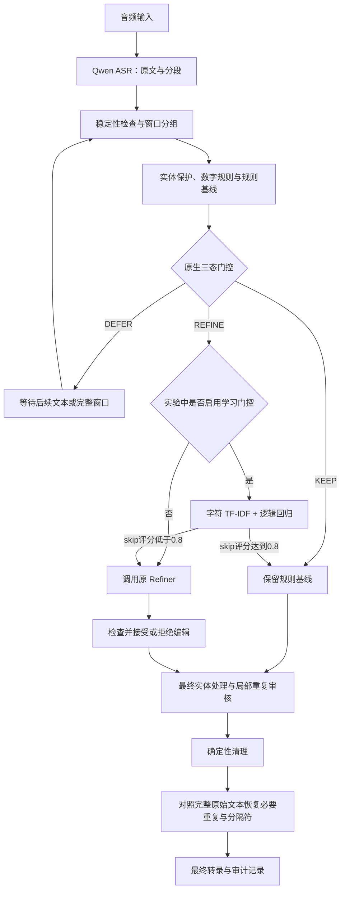

# 当前门控实现与近期改进记录

更新日期：2026-10-12。本文覆盖最近的门控训练、重复保护修复和转录评测；所有数字均来自项目中保存的运行报告。

## 1. 先说明当前状态

目前有两套需要区分的门控：

| 项目 | 当前状态 | 作用 |
|---|---|---|
| 原生规则门控 | 8081 服务健康接口报告 `tri_state`；启动脚本也默认使用该模式 | 根据文本信号和流式稳定性，决定 KEEP / DEFER / REFINE |
| 最新学习门控 | 已训练、冻结并完成实验；2026-10-12 随后按用户要求在 8081/8051 开启试运行 | 对原生门控准备执行的窗口精修，再判断是否值得调用 Refiner |
| 重复保留与恢复 | 已修改源码，并在冻结实验运行时验证 | 防止正常重复被误删；它是编辑保护，不是学习门控模型 |

2026-10-12 曾按要求开启学习门控、关闭学习及原生门控，最新又按要求恢复学习门控。当前两个 Web 实例的健康状态为原生 `tri_state`、学习门控 `on`、模型已加载、阈值 0.8、zh-itn 数字后端；ASR 8766 保持运行。最新部署参数、GPU 和状态记录见 `.runtime/services/current-gate-deployment.json` 指向的部署目录，历史记录保留。

当前原生门控为 `tri_state`、学习窗口门控为 `on`：原生门控先判断，学习模型再决定是否跳过原生 REFINE 窗口。学习门控启用需要原生三态模式；局部审核继续按原流程运行。`LEARNED_WINDOW_GATE_MODE=off|shadow|on` 的启动默认值仍为 off；原生门控另由 `REFINEMENT_GATE_MODE=off|conservative|tri_state` 控制。此前试运行结果与限制见下文；用法见 [学习窗口门控开关](LEARNED_WINDOW_GATE_SWITCH.md)。

最近评测没有使用 ASR 声学置信度。代码保留了相关字段，但只有分数经过校准、且覆盖当前文本时才允许参与判断。学习模型的文本评分也没有校准，不能把它解释为 ASR 识别正确概率。

## 2. 门控在整个流程中的位置

最近验证的主要处理顺序如下。学习门控在实验策略或开启启动开关时启用。



原生 KEEP 只表示跳过这个窗口的 Refiner 调用。后续实体处理、局部重复审核等阶段仍可能执行，所以不能把窗口 KEEP 理解为“这条转录以后不再调用模型”。

最近实验使用 K=3 的窗口组织方式，窗口字符预算为 80。局部审核等待稳定范围和足够上下文，不直接对每个刚出现的瞬时重复执行删除。

## 3. 原生规则门控怎么判断

主要实现：[system/refinement_gate.py](system/refinement_gate.py)，接入位置：[system/web_app.py](system/web_app.py)。

### 3.1 三个动作

| 动作 | 意义 | 常见触发情况 |
|---|---|---|
| KEEP | 本次不做窗口精修 | 空文本、与上次精修相同、稳定且没有清理信号、数字已交给规则处理 |
| DEFER | 暂缓本次处理，等待更完整或稳定的输入 | 非最终文本仍不稳定、处于精修冷却期、窗口分组未完整 |
| REFINE | 调用 Refiner | 未解决的实体提示、重复/口语词/自我纠正等清理信号，或满足其他精修条件 |

### 3.2 判断依据与顺序

`tri_state` 的主要判断顺序为：

1. 空文本、已精修过的相同假设：KEEP。
2. 非最终文本仍不稳定或处于冷却期：DEFER。
3. 有未解决的实体提示，或可交给模型的清理信号：REFINE。
4. 只有数字格式问题、且交给确定性数字规则处理：KEEP。
5. 如果确有经过校准且完整覆盖文本的 ASR 置信度，再进入置信度分支。
6. 最终文本必须结束等待：无其他信号、置信度不可用且句子有结束标点时通常 KEEP；缺少结束标点时可触发 REFINE。`refine_on_unverified_confidence` 配置会改变这部分行为。
7. 其余稳定、无清理信号的文本通常 KEEP。

其中，可信 ASR 置信度低于 0.80 可触发 REFINE，高于配置的高置信度阈值（默认 0.92）可 KEEP。但最近实验明确关闭了该输入，这两个数没有承担本轮门控的实际置信度计算。

清理信号主要包括：重复字符/短语、部分口语填充词、自我纠正表达、孤立单字分句异常以及数字表达。信号表示“可能值得审核”，不等于已经确认可以删除。

流式稳定性也不只看句子样式：还跟踪连续未变化的更新、相邻假设的改写比例、尾部持续时间及句子是否完整。`HypothesisTracker` 默认两次不变更新和 600 ms 参数，也允许较小幅度的连续追加进入处理；不能简单概括为“每句话都必须等 600 ms”。

### 3.3 原生门控的边界

它能避免反复处理不稳定尾部，以及明显没有精修需求的文本。但重复或填充词识别仍主要来自人工定义的文本模式，难以可靠区分口吃、强调、引用和跨句衔接。

## 4. 最新学习门控怎么实现

训练代码：[experiments/scripts/train_terminal_gain_linear.py](experiments/scripts/train_terminal_gain_linear.py)。

实际流式适配器：[experiments/scripts/stream_linear_gate_holdout.py](experiments/scripts/stream_linear_gate_holdout.py)。

### 4.1 模型与输入

最新选中的模型是 **字符 1–3 gram TF-IDF + Logistic Regression**，模型目标为 `terminal_quality`。它在 CPU 上评分。

输入只使用动作执行之前能看到的信息：

- 当前窗口的原始文本 `raw_text`；
- 实体/数字等准备后的规则结果 `baseline_text`；
- 任务类型和领域；
- 接口支持左侧上下文，但当前训练及最新窗口实验将它置为空字符串。

参考答案、期望清理结果、终态输出、收益标签和实际耗时不作为预测输入。当前模型也不读取音频、声学特征或 ASR token 概率。

### 4.2 判断逻辑

先让原生门控判断，学习模型仅对原生 REFINE 的窗口评分：

```text
原生 KEEP / DEFER：直接保留原动作，不运行学习模型。

原生窗口 REFINE：
    skip_allowed 评分 >= 0.8：改为 KEEP，跳过该窗口精修。
    skip_allowed 评分 <  0.8：保持 REFINE。

局部重复审核：不使用最新学习模型否决，继续走原生审核及保护。
```

这里的 0.8 是 **skip_allowed 的文本分类阈值**，不是“ASR 置信度 80%”，也不是“有 80% 把握删掉重复”。模型只控制调用，不直接改字。

当前方案是收缩调用的筛选器：不能把原生 KEEP 升级成 REFINE。因此，原生门控漏掉的精修需求，它也无法主动补上。

### 4.3 训练标签为什么改了

早期按单个窗口或局部操作的即时输出判断收益，容易与后续补救脱节。同一处重复可能在窗口和局部审核中各记一次 benefit；跳过窗口后，后续局部审核也可能仍然修好它。

现在通过执行反事实分支生成窗口标签：

1. 按原策略跑完整条转录。
2. 将指定窗口从 REFINE 改为 KEEP，其他处理阶段保持原流程。
3. 再跑完整条转录，比较最终参考距离。
4. 跳过后距离变差，表示原窗口精修有益；距离不变，表示该操作没有观察到终态质量收益。

这仍是参考相关的弱标签，并不等于人工确认的正确编辑。质量中性也不一定省成本：后级可能增加补救调用。因此质量、Refiner/MLM 调用及耗时分开记录。

训练有 292 个窗口标签，来自 818 个 ASR 视图、441 组已有录音；开发有 143 个标签，来自 288 个视图、162 组已有录音。清晰/加噪版本不能算成不同的独立录音。样本按录音组与模板加权。

阈值只在开发分区选择，要求没有视图参考距离退化、保留全部观察到的有益窗口，再比较成本。开发数据被复用，不能作为独立测试。

## 5. 最近做了哪些改进

### 5.1 失败归因和统计口径修正

将局部操作配对与整条转录分开统计，检查两个阶段是否在重复计算同一处收益。补充了实际顺序回放、原策略重复控制、调用重试和辅助 MLM 成本记录。

正向结果：早期 22 条已消费录音的冷快照诊断中，原策略和学习策略最终文本相同，Refiner 调用 11→6。

负向发现：两策略都出现强调内容误删；强制精修能修的一些内容，原生 KEEP 与学习否决都无法补调用。该回放没有真实音频流时序，也没有验证整体提速。

### 5.2 尝试小型 BERT 双任务门控，并记录失败

训练过约 880 万参数、4 层、hidden=256 的 BERT 学生，尝试同时筛选窗口精修和局部审核；比较三分类收益/中性/有害及二分类方案，并加入局部效果监督。

开发集指标看起来较好，但新 32 段合成语音流式测试失败：Refiner 调用 24→19，参考完全匹配却从 22/32 降至 18/32，脚本 CER 从 3.383% 升至 4.323%。

五次省调用中四次对应漏修，例如“剩剩余量”“标标在”“控控制”。这是明确负收益，不能用调用减少掩盖；该双任务方案没有上线。

### 5.3 收缩为窗口门控，恢复局部审核

学习模型只筛选窗口，局部审核恢复原流程，让后级保留修复机会。同时补充终态对照完整原文的重复恢复，处理较晚出现的保留指令。

旧 32 段回归中，两侧参考完全匹配均为 23/32；窗口恢复阶段的冻结新 20 段合成 v1 对照中，两侧均为 13/20，Refiner 调用 16→14。相对原策略，本批没有新增参考距离退化；随后修标点的 v2 使用这批已消费样本，只作回归。

负向发现：新 20 段省下的 Refiner 实测时间约 511 ms，但 BERT 门控评分约 447 ms，抵消了大部分节省。说明小模型评分开销也必须计入，少调用两次不一定明显更快。

### 5.4 完整原文重复恢复与引用标点兼容

终态会在局部审核和确定性清理之后，检查原文中的受保护重复，恢复可明确对齐的完整副本。保护覆盖部分否定重复、程度表达、分配式重复及明确保留指令。

修复了“前面的已经备案，说了两遍”中间插入逗号时无法识别具名引用的问题，避免把指令错误关联到其他较近重复。

正向结果：该例参考距离 6→2，恢复了“已经备案”的重复。

负向边界：整句仍未完全修好，新 20 段修后回归仍为 13/20；不能把部分恢复描述成整句正确。终态恢复发生时会将展示的 source spans 合为完整原文→结果的一条记录，失去原 K3 分组粒度；不会倒灌到不同分组的窗口缓存。

### 5.5 换成轻量线性模型，并扩展终态标签

采用前述终态反事实标签训练 TF-IDF 线性模型，替代最新实验中较重的 BERT 评分路径。原 Refiner 权重和 float32 精度保持不变。

开发集终态回放：完全匹配均为 206/288，CER 均为 4.383%；Refiner 185→166，减少 10.3%；观察到的 14/14 有益窗口均保留。

实际 Web 回调评分均值约 1.531 ms，离线评分估计约 0.647 ms。二者测量范围不同；不能混用。

负向边界：这是复用开发数据、冻结 final ASR 响应的回放，没有发送音频；本轮终态标签没有 harm 样本，不能声称风险已校准。字符模型是低成本基线，尚无证据表明其具备可靠的语义意图理解。

### 5.6 补充真实流式与不同来源验证

改用按捕获时钟发送的真实 WebSocket 音频、真实 HTTP ASR，每会话独立缓存，两轮反转策略顺序；记录音频结束后的完成滞后、发送积压、背压、p50/p95/最大值及失败。

第一批 24 段 AISHELL 朗读 + 24 段 Qwen TTS，共 192 会话：

- 合成部分 Refiner 40→32，减少 20%，参考 CER 两侧均为 2.184%。
- 朗读部分 Refiner 均为 2；学习窗口门控实际评分为 0 次，因为没有原生窗口 REFINE 机会。
- 朗读部分没有检验“学习门控触发后是否正确”，也没有证明真实语音提速。
- 部分朗读配对的 ASR 输出/假设历史存在波动，不能将所有输出差异归因于门控。

### 5.7 修复跨分句“索引/名单”误删

原始文本“检查索引，索引交给值班员”在窗口合并后可能丢掉逗号，局部审核看到“索引索引”，误判为口吃。

新增原始文本锚定的保护：要求原文有分句标点，重复单元是至少两个字的名词，前面有词汇动词，后面有谓词。使用独立 Jieba 词性标注器，避免实体自定义词典干扰，并在启动时预热。

具体提交点有两层：局部审核读取缓存/调用模型之前检查；编辑提交时再次检查。终态再恢复明确对齐但丢失的原始分隔符。保留与恢复不会直接撤销无关实体或数字规范化。

已消费的 48 段音频、49 个保存 ASR 视图做相同输入冷快照回归：参考完全匹配 38/49→40/49，距离总和 17→13，Refiner 21→19。仅索引/名单两例变化，其余 47 个最终文本逐字相同。

负向边界：这仍是词性启发式；真正的名词口吃恰好符合该结构时可能被保留，无标点或词性错误会漏检。它不是依存分析或学习意图模型。直接证据来自回归和针对性测试。

### 5.8 新自然口语验证

固定选择 18 段此前项目评测未使用 ID 的 SpeechIO 音频，来自六个分片，未按本轮模型输出筛选。每段两轮、两种策略，共 72 会话、36 对；门控模型和 0.8 阈值保持冻结。

| 指标 | 原策略 | 最新学习窗口门控 |
|---|---:|---:|
| Refiner 调用 | 24 | 20 |
| 规范化参考 CER | 2.7586% | 2.7586% |
| 原字词参考 CER | 4.4983% | 4.4983% |
| 规范化参考完全匹配 | 20/36 | 20/36 |
| 音频完成滞后 p50 | 0.185 s | 0.134 s |
| 音频完成滞后 p95 | 0.872 s | 0.915 s |
| 音频完成滞后最大值 | 1.304 s | 1.259 s |

正向：Refiner 调用减少 16.7%；学习门控评分 12 次、否决 4 次，累计评分约 22 ms。36/36 对原始 ASR 与假设历史相同；34/36 对最终文本逐字相同，另两对仅逗号不同，参考距离不变。

负向与未确定项：

- 完成滞后分片等权均值差为 −31.6 ms，95% bootstrap 区间为 [−69.2, +4.9] ms，包含零；p95 还略高，尚未证明稳定加速。
- SpeechIO 参考是逐字转写，含填充词和重复，不是期望精修结果。CER 相同只证明本批参考距离相同，不能据此证明精修语义质量不变。
- 新自然批次没有触发跨分句保护，不能作为该保护在新自然语音上成功的正例。
- 只有 18 段音频，72 会话不是 72 个独立样本；六个来源分片也不等于六组独立说话人。音频未独立听音复核，源文本曝光及 ASR 预训练重叠未知。

## 6. 正向与负向结果汇总

| 改进或尝试 | 正向证据 | 负向或限制 |
|---|---|---|
| 双任务 BERT 学生 | 新流式测试调用 24→19 | 完全匹配 22→18，四处漏修；失败方案 |
| 窗口限定、恢复局部审核 | 新 20 段参考结果相同，调用 16→14 | BERT 评分开销抵消大部分节省 |
| 完整原文恢复 | 补回晚到保留指令对应的重复 | 保守对齐会漏检；合并终态 source spans |
| 引用标点兼容 | 单例距离 6→2 | 整句仍未正确，只是已消费回归 |
| 终态标签 + 线性模型 | 开发回放调用 185→166，14/14 有益窗口保留 | 开发数据复用、无 harm 标签、无音频时序 |
| 合成真实流式留出 | 调用 40→32，参考 CER 不变 | 弱脚本、模板有限；不能直接外推自然语音 |
| 真实朗读验证 | 基础处理链与配对得到检查 | 学习窗口评分 0 次，未检验实际路由能力 |
| 跨分句保护 | 两例恢复，回归匹配 38→40，其余不变 | 词性启发式，缺少新自然正例 |
| 自然口语验证 | 调用 24→20，本批参考距离相同 | 加速未确定；没有人工确认的精修目标 |

## 7. 当前可以得出的结论与下一步

目前支持的结论是：限定为窗口筛选、保留原生局部审核，并使用廉价线性模型后，在已测的合成和自然口语样本中减少了部分 Refiner 调用；两项共享流程误删也已完成源码修复及回归验证。

仍不能声称门控已可靠判断重复意图、实现风险校准、保证自然语音零误删或带来稳定端到端提速。早期双任务方案的明确退化说明，不能只追求少调用。

下一步优先建立独立自然口语的精修目标：保留原始音频、逐字转写及期望清理文本，覆盖真实口吃、跨句衔接、强调、否定、引用和填充词。模型/阈值冻结后分别评价有益调用保留、误删/漏修、总模型成本与端到端延迟。跨分句保护还需要独立自然正例及反例。

已用于分析或修规则的样本都标记为 consumed，只能继续做回归；调参后不能再称同一批数据为独立验证。重复保护阶段相关测试 166 项通过，实验完成产物和哈希已经保存；新增开关阶段相关测试 124 项通过，两组测试有重叠，不累加成独立测试总数。Luna 负责独立只读核对。随后按用户要求开启试运行，三个服务已重启，两个 Web 的真实音频链路检查通过；模型与阈值保持冻结。

## 8. 代码与实验依据

| 文件 | 内容 |
|---|---|
| [scripts/start_web.sh](scripts/start_web.sh) | 服务启动配置及默认关闭的学习窗口门控开关 |
| [system/learned_window_gate.py](system/learned_window_gate.py) | 最新线性模型加载、shadow/on 路由、异常回退和状态计数 |
| [system/refinement_gate.py](system/refinement_gate.py) | 原生三态门控与稳定性跟踪 |
| [system/web_app.py](system/web_app.py) | 窗口路由、实验 callback、局部审核和最终处理 |
| [system/weak_refinement_gate.py](system/weak_refinement_gate.py) | 早期 BERT 学生实现，非最新线性模型 |
| [system/repetition_preservation.py](system/repetition_preservation.py) | 重复保护、原文对齐恢复和跨分句词性规则 |
| [train_terminal_gain_linear.py](experiments/scripts/train_terminal_gain_linear.py) | 最新 TF-IDF 线性模型训练与开发选择 |
| [stream_linear_gate_holdout.py](experiments/scripts/stream_linear_gate_holdout.py) | 最新学习模型实际流式评测适配器 |
| [失败归因报告](results/gate_failure_audit_20261010/REPORT.md) | 操作计数纠正、共有误删和 KEEP 盲点 |
| [第三轮报告](results/gate_round3_20261011/REPORT.md) | 双任务学生的独立流式退化 |
| [窗口恢复报告](results/gate_window_recovery_20261011/REPORT.md) | 收缩范围、完整原文保护及评分开销 |
| [终态标签与线性模型报告](results/gate_terminal_gain_round4_20261012/REPORT.md) | 标签、训练、开发选择与冷终态回放 |
| [首次真实流式留出报告](results/gate_linear_holdout_20261012/REPORT.md) | 朗读与合成来源分别评测 |
| [跨分句修复与自然口语报告](results/gate_clause_repetition_guard_20261012/REPORT.md) | 两例回归、新自然口语对照、延迟区间 |
| [最新 Luna 独立审计](results/gate_clause_repetition_guard_20261012/LUNA_AUDIT.md) | 冻结代码、输入配对、结果与解释边界 |
