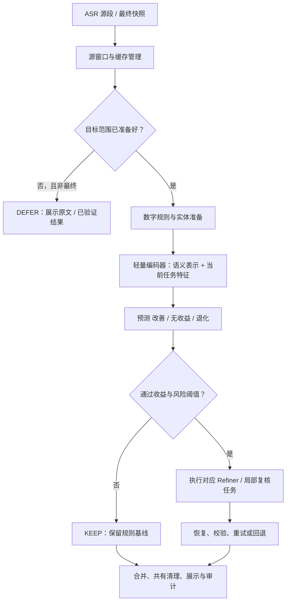

# 学习型精修门控落地方案

日期：2026-10-09。

本文件是一份可实施设计。2026-10-10 已训练独立的合成弱监督门控原型，GPU 拟合、CPU 评分，检查点和实测见 [原型报告](/home/aim0/桌面/tan/ASR/Codex-web/results/learned_gate_weak_prototype_20261010/REPORT.md)。它尚未完成真实语音校准、会话回放或线上验收；下文的生产路由配置仍属于拟实现内容。原型减少调用的同时漏掉了部分清理收益，目前保留既有门控。既有实体判别器的分类头没有用于门控初始化。

推荐采用“成对收益监督 + 退化风险约束”的轻量学习型门控。模型在调用 Refiner 之前预测：执行这一次处理，相比保留当前规则结果，会改善、无收益还是退化。第一版不依赖 Qwen ASR 置信度，也不以正则命中作为调用模型的必要条件。

## 1. 冻结第一版范围

第一版服务于当前中文及常见中英混合转录，覆盖两类实际会消耗模型计算的任务：

| 任务 | KEEP 的含义 | REFINE 的含义 |
| --- | --- | --- |
| window_refine | 输出数字与实体处理后的基线，执行双方共有的确定性清理 | 调用当前 Refiner，执行现有恢复、校验、严格重试和回退 |
| local_edit_review | 保留当前文本，不执行该候选的神经复核 | 调用现有局部重复／删除复核，必要时经过 plausibility 分支，再按现有约束决定修改 |

DEFER 只表示上下文或源窗口尚未准备好；最终阶段必须落到 KEEP 或 REFINE。分类器不直接改字、不直接接受候选，也不放宽实体和数字保护。

第一版保持 VAD 完成段、K=3 分组、源窗口缓存、latest-only 和既有 finish 收尾。这样能够单独验证学习型调用决策的贡献。基于稳定前缀的更早调度作为第二阶段的独立实验，避免把分段变化、输入变化与门控效果混为一谈。

保留原有 tri_state 作为窗口组织方式，另增加 `refinement_router=rules|shadow|learned`。不要仅向原门控枚举加入 learned 后直接使用：当前多处用 `mode is TRI_STATE` 决定标点分组，直接增加枚举会意外改变窗口路径。

## 2. 运行流程



图中局部复核在原有候选就绪的位置运行，同样调用路由器。图不要求将所有重复复核搬到窗口精修之前。

原有正则清理信号可以作为一个消融组的辅助特征，但正式主模型必须有“不输入正则特征”的版本。已验证实体、数值和源范围等执行约束继续由独立校验器负责。

## 3. 确定模型，而不再增加一个生成式预审模型

复用本地预训练编码器 `models/entity_ranker/encoder` 的初始化。已核对 config：BERT、4 层、隐藏维度 256、4 个注意力头、词表 21128、最大位置长度 512。其上游为 [UER 中文小型 RoBERTa](https://huggingface.co/uer/chinese_roberta_L-4_H-256)。

复用的是预训练编码器初始化和加载经验，不是先前被否决的实体 verifier 分类头或其决策阈值。门控使用独立目录、训练数据、检查点和模型版本。

**网络结构：**

1. 共享 4 层中文编码器，输入当前可见上下文及待处理文本。
2. 窗口任务使用 CLS 表示；局部复核再拼接候选跨度的池化表示。
3. 数值特征经过一个小型 MLP，与语义表示拼接。
4. 两个任务分别使用三分类头，输出 `p_benefit / p_neutral / p_harm`。

第一版使用交叉熵训练，按任务分别校准输出。以未加权交叉熵作为基线；稀有退化样本的重采样或加权只在训练集进行，并作为消融，不能改变验证／测试的自然分布。模型选择以验证集质量—成本曲线为主，不能只看分类准确率。

初始训练设置建议：AdamW；编码器学习率 2e-5，新增头 1e-4；batch size 32；最多 5 个 epoch；以开发集早停。它们是试验起点，不是声称已经最优的参数。

推理先在独立 CPU 工作线程执行，限制并发，避免阻塞 WebSocket 事件循环。记录 p50/p95 和实际 CPU 消耗。暂定常规输入（≤256 tokens）门控 p95 目标为 30 ms；长输入单独报告，并要求总开销明显小于节省的模型时间。2026-10-09 微基准已显示 512 tokens 在双线程下约 42 ms，不能把 30 ms 承诺到所有输入长度。详细证据见 [CPU 开销实测](/home/aim0/桌面/tan/ASR/Codex-web/results/learned_gate_latency_20261009/REPORT.md)。

## 4. 输入必须是决策时已经存在的信息

**窗口任务输入：**当前规则基线、可用的左侧原始 ASR 上下文、源窗口修订情况、实体与数字处理的摘要。保留原始源窗口供审计和可选输入消融。

**局部复核输入：**当前可见的复核上下文、候选 source/target 及原文偏移、候选类型。候选必须在调用此次复核之前已经形成。源自上一次 Refiner 的删除建议可以使用，但那次已发生的调用必须计入总成本。

建议第一版数值特征：

| 特征组 | 具体字段 |
| --- | --- |
| 窗口状态 | 字符／token 数，块数，是否最终，未变化次数，活动尾部修订比例 |
| 实体 | 已验证实体数，未确认候选数，最佳候选与竞争候选的间隔，存在歧义的标志 |
| 数字 | 规则是否启用，规则修改数量，受保护数值／实体数量 |
| 局部复核 | 候选跨度长度、拟删除长度、候选种类、可用上下文范围 |
| 环境 | 语言、领域、任务类型、版本标识；排队情况用于调度，不用于冒充文字正确率 |

第一版不使用 ASR probability。第二版可以增加有位置与版本对应关系的 token 分数及 missing mask；缺失不能填成“高置信度”。top-5 token 概率不等于完整分布，也不等于 N-best 整句候选。

编码长度最多 512 tokens，按实际长度动态 padding，常规输入争取控制在 256 tokens。优先保留完整目标窗口及候选，其次保留左侧上下文。只能裁剪上下文；若目标本身超长，返回显式 unsupported/KEEP 并记录原因，不能静默截掉待判断文字。非登记语言／领域采用同样的显式保留策略，支持范围需在模型清单中说明。

同一上下文包含多个局部候选时，缓存编码结果并按跨度池化；只有在输入表示完全一致时才能复用。不要为每个重复字符重新编码同一段长上下文。

**禁止作为当前决策输入：**本次 Refiner 尚未生成的答案、本次校验结果、最终全文、未来 ASR 假设、参考答案、人工标签。此前已经发生的操作结果必须用事件时间证明其可见性。

## 5. 标签由真实成对执行产生

对同一个决策时刻的源状态 s，冻结模型、提示词、词库快照、数字规则、窗口策略和校验器：

```text
b(s) = 此时不执行待决神经任务的输出
r(s) = 此时执行待决神经任务，经过现有验证／回退后的输出
label(s) = 根据参考与人工审核，对 r(s) 相对 b(s) 标注收益
```

这是离线成对执行；在线只执行门控选中的分支。对照分支应从同一状态快照分叉，不能先跑一条再让其缓存或会话记忆影响另一条。

| 标签 | 标注条件 |
| --- | --- |
| benefit | 修复真实错误，或完成符合最终意图的口语整理，且没有新增事实错误或关键信息损失 |
| neutral | 输出不变、被回退到同一基线，或仅产生无明确收益的可接受风格变化 |
| harm | 新增事实、错误数字／实体、否定变化、关键内容损失，或相对基线出现实质质量退化 |
| uncertain | 原音／参考存疑、目标跨度无法可靠对齐、人工分歧未解决；单独保留，不强塞入三分类 |

同一次操作既有改善也有事实性误改时，以 harm 标注。被校验器接受不等于 benefit；实体候选召回成功不等于 benefit；出现文字变化也不等于 benefit。

ASR 准确性用 verbatim 参考核验，口语整理用 intended 参考核验。数字等价格式与合法口癖删除不能被普通 CER 当作事实错误；也不能为了降低 CER 删除实体、否定或数量。用 CER/MER 和固定规则预筛，所有发生实质变化的收益／退化标签需要人工复核，正确原文、稀有名称及正常叠词应进入负例。

流式快照的 intended 参考只能要求该时刻已有证据支持的意图。例如后续才出现“不是今天，是明天”，不能要求更早的窗口提前知道“明天”。无法可靠对齐到当前源范围的参考需人工处理或标为 uncertain，不能直接把最终整篇 Clean 文本切几段当作局部真值。

风险校准／最终测试中的 uncertain 样本不能在看到某个政策的结果后悄悄删除：要么事先按参考可核准性固定所有政策共同的评测集合，并报告排除量；要么采用预先声明的保守计分。训练中的不确定标签处理与风险评测的分母必须区分。

已有日志只能提供输入、输出和成本，不能直接提供可靠收益标签。当前规则跳过的窗口也必须抽样执行 Refiner 获得成对结果，否则训练集会继承原门控的盲区。少量合成数据可以辅助训练，但主要验收必须来自真实 ASR。

先用约 500 个分层决策快照做可行性试验，检查当前 Refiner 是否确实存在可选择的正收益。如果真实正收益极少，门控只能减少无用／有害调用，不能创造 Refiner 本身没有的纠错能力。

确认存在收益后，再扩到约 1万–2万条窗口与局部复核快照。数量只是首轮工程目标；必须同时报告独立录音、说话人／来源组、领域、任务和三类标签数量。样本量以退化事件及校准精度是否足够为准。

## 6. 划分与因果可比性

先按原始录音／节目／说话人等来源建组，再分训练、开发、风险校准和最终测试四部分。参考句近重复、同一录音的噪声版本、相邻窗口和不同门控产生的相同决策状态必须留在同一组。

建议开始按组使用 60% / 15% / 10% / 15%；若风险校准独立组数不足，扩大该部分或收集新数据，不能靠切更多窗口补足。此前反复用于改规则的 5 条项目音频、医学开发探针和已查阅错误，只能作为开发／回归材料。

门控训练标签必须来自当前冻结 Refiner 与验证链。更换 Refiner、提示词、规则或重试策略后，需要重新检验标签是否仍代表真实收益。

局部成对标签只是代理目标。前一次修改会改变后续复核上下文，必须另做完整按时间顺序的会话回放。最终政策的输出与总成本以完整回放为准，不能简单拼接每个窗口的最优结果来宣称系统收益。

## 7. 调用政策和风险校准

对每种任务 t，使用两个阈值：收益阈值 τB,t 和退化阈值 τH,t：

```python
if not source_ready and not final:
    action = DEFER
elif unsupported_or_invalid_or_timed_out:
    action = KEEP
elif p_benefit >= tau_benefit[task] and p_harm <= tau_harm[task]:
    action = REFINE
else:
    action = KEEP
```

每个普通窗口和每个局部复核任务都经过该政策。模型内部一次严格重试属于已选择操作的固定执行方式，其成本和最终输出已经包含在训练标签中。队列满时保留最新待处理源版本，丢弃过时任务；最终超时输出可审计的规则基线。

不要先写死“0.8 表示值得精修”。在开发集寻找少量质量—成本有竞争力的阈值组合，随后冻结，交给独立风险校准集检验。

建议把风险定义在最终完整会话上：

```text
R(policy) = P(该政策的最终输出相对共有规则基线产生实质退化)
```

同时报告相对当前正则门控的成对改善与退化、被调用任务中的退化比例、漏掉的有益任务。上述指标分母不同，不能混用。

校准时对每个冻结候选政策执行完整回放，计算会话风险的单侧上置信界。若测试多个阈值／任务／领域，使用预先声明的多重检验校正或 Learn-then-Test；不能在同一校准集挑完阈值后套单策略区间。

例如可以把“目标会话退化风险 ε=1%，置信水平 95%”作为研究目标，但它不是已达成性能。即使没有观察到退化，单个事先固定政策也约需 299 个独立试验单位才能支持该水平的简单二项上界；多个候选需要更多。来自同一录音的几百个窗口不能作为几百个独立单位。

窗口／录音存在组内相关时，以独立来源组为试验单位并明确组级损失；若只能做按来源聚类的 bootstrap，应称为经验不确定性估计，不能宣称已经取得有限样本分布无关保证。跨域部署还需要同域校准或单独报告，不能将新闻校准外推到医疗。

若没有阈值同时满足风险、质量与节省成本的目标，则该检查点不能通过 learned 上线验收。不能以全 KEEP 得到低风险就判定成功。

风险控制的统计思路参考 [Learn then Test](https://arxiv.org/abs/2110.01052)；本方案对 ASR 会话退化损失的定义与具体实现仍需验证。

## 8. 为什么使用这种监督目标

[RouteLLM](https://arxiv.org/abs/2406.18665) 使用偏好数据学习调用较强模型的收益。这里将比较对象替换为“保留规则结果”和“执行当前精修操作”，并显式区分无收益与退化；局部复核也作为独立任务建模。

[Multi-stage LLM Correction](https://arxiv.org/abs/2310.11532) 已使用 ASR 不确定性进行选择性纠错。因此“加一个门控”本身不是新贡献；本方案重点研究缺少可靠 ASR 置信度时，操作后的真实收益能否被低成本预测。

[Fewer Hallucinations, More Verification](https://arxiv.org/html/2505.24347) 把预检测、纠错与验证组合起来，但其单加预检测的消融并未保证优于原 ASR。本项目也已有文字判别器和音频重评分退化记录，不能直接把“看起来不通顺”解释为正确的自动替换证据。收益标签应评价经过完整验证后的结果。

这些论文提供方法依据，不证明本方案已取得同等结果，也不构成对本方案原创性的保证。

## 9. 接入当前代码的具体位置

| 文件 / 位置 | 拟实现职责 |
| --- | --- |
| `system/refinement_gate.py` | 保留既有模式作为基线；共享 GateDecision，扩展路由来源、任务类型和预测字段 |
| 新增 `system/learned_refinement_gate.py` | 编码器、两类任务头、批量局部候选评分、bundle 校验、阈值与异常保留 |
| 新增 `system/gate_features.py` | 构造因果可见输入、特征规范化、源跨度与缓存键；训练和服务共用 |
| `system/web_app.py::refine_update` | 数字与实体准备完成后调用 router；替换普通窗口的调用决定 |
| `system/web_app.py::review_final_repetition_text` | 在候选上下文准备好后、调用复核模型前执行 local_edit_review 路由 |
| `system/web_app.py` 局部删除复核循环 | 同样接入路由，不能绕过门控或漏算成本 |
| `system/window_refinement.py` | 保留源所有权；缓存键补入 gate／规则／模型版本；准确处理 KEEP 缓存和源修订 |
| `scripts/start_web.sh` / Web 参数与 health | 增加 router 配置与 bundle 版本；保持 tri_state 的分组行为 |
| 新增 `experiments/scripts/collect_gate_pairs.py` | 从冻结状态生成成对结果，覆盖原门控 KEEP 的窗口 |
| 新增 `experiments/scripts/train_refinement_gate.py` | 训练两类任务；记录来源组和输入版本 |
| 新增 `experiments/scripts/calibrate_refinement_gate.py` | 校准概率、冻结候选政策、独立风险检验 |
| 新增 `experiments/scripts/evaluate_refinement_gate.py` | 固定窗口实验 + 有状态会话回放 + 实际音频性能报告 |

旧批处理和麦克风 CLI 后续复用相同 GateRequest/GateDecision；它们当前提示词、数字处理与 Web 不完全一致，不能直接声称同一个 bundle 已经跨入口验收。第一版明确只接入当前 Web 链路。

## 10. 接口与模型包

拟定 GateRequest 的最小字段：

```text
session_id, source_revision, task_kind, source_start, source_end
raw_text, baseline_text, available_context
candidate_source, candidate_target, candidate_offsets（仅局部复核）
language, domain, entity_features, numeric_features, stability_features
source_ready, final, available_at, pipeline_version
```

拟定 GateDecision 字段：

```text
action: KEEP | DEFER | REFINE
router: rules | learned | shadow
p_benefit, p_neutral, p_harm, effective_thresholds
task_kind, reason_code, router_latency_ms
model_version, feature_version, pipeline_version, source_revision
```

模型包至少包含编码器与 tokenizer、任务头、特征顺序及归一化参数、任务概率校准参数、已验收阈值、语言／领域支持范围、训练与校准来源清单哈希、Refiner／协议／验证器／数字规则版本。

实体库内容哈希记录在每次实验和运行中；动态词库的正常修改不自动成为已验证的跨域泛化能力。大规模词库变化或新增领域需重新验收。缓存键包含实际有效输入和相关配置版本；模型结果回到前端前再次检查源 revision，防止过时决策覆盖新文本。

## 11. 部署行为与降级

| 模式 | 行为 |
| --- | --- |
| rules | 运行现有规则门控，作为可复现基线 |
| shadow | 实际决策仍用 rules，同时记录 learned 预测；离线补齐未执行动作的标签 |
| learned | 由学习型门控决定普通精修与局部复核；独立保护与校验继续执行 |

learned 启动必须检查 bundle 完整性、输入 schema、Refiner 与处理链版本兼容性。缺少模型或阈值时拒绝启动该模式，不能把影子输出伪装成神经门控已接管。

运行时超时、NaN、无法对应源跨度、超出支持范围时：保留已验证基线／当前文本，记录明确原因。需要恢复旧体验时显式切回 rules。最终阶段不允许无限 DEFER，也不能因门控失败丢失完整 ASR 文本。

先在独立 Web 实例进行 shadow 和真实音频验收，再切换正式服务。每个会话固定一个 bundle；热更新只影响新会话。不要在线随机探索可能有害的改写，成对探索先在离线回放完成。

第一版入口仍使用 `refinement_gate_mode=tri_state`；拟新增的 router 设置与它正交。上述设置不是当前项目已经支持的命令。

## 12. 必须补齐的成本账本

将逻辑任务与实际推理成本分开记录：

- 普通生成、严格重试、局部候选评分、plausibility 及其子批次。
- 路由器自身耗时、特征准备、缓存命中、锁等待、排队与取消。
- 每千字总逻辑调用数、实际 forward／generate 数、总 token、GPU 时间及完整会话墙钟。

当前局部候选比较可能对原句和候选分别做 forward，plausibility 也可能执行多个掩码批次。一次逻辑调用不能直接等同一次 GPU 前向。并行模型耗时也不能直接相加当作端到端时间。

第一步先测当前成本构成，估计普通窗口精修与局部复核分别有多少可节省空间。若主开销来自 ASR/VAD，门控减少 Refiner 计算不一定明显缩短整段墙钟。

## 13. 上线验收目标

以下为需要冻结后验证的建议门槛，不是已取得结果：

| 检查 | 建议目标 / 判定方式 |
| --- | --- |
| 规则基线对照 | 固定同一 ASR 输入、窗口、词库、数字与验证配置，独立比较规则门控与 learned |
| 可用精修收益保留 | 在有真实正收益的候选任务中保留至少 95%；同时报告置信区间和遗漏类型 |
| 实质退化 | 相比现规则门控不增加；按预先声明的会话风险目标进行独立校准与报告 |
| 总模型成本 | 相比当前规则门控至少减少 20% 作为首轮研究目标，包含局部复核和路由器本身；必须扣除新增评分开销，不能只用 Refiner 调用下降比例作为通过条件 |
| 路由性能 | 常规输入（≤256 tokens）本机 p95 目标 ≤30 ms；长输入、总开销和实际并发另行报告 |
| 会话性能 | 同机同音频、暖机后交替重复，报告 p50/p95；质量回放不替代音频耗时测试 |
| 工程正确性 | 源修订缓存失效、finish、超时、模型包不匹配、禁用／切回、重复复核均有集成验证 |

20% / 95% 是可否证的目标；若原门控已接近可达上限，应如实报告达不到，不为满足数字而丢弃有益处理。业务验收还需检查领域、噪声、长音频的分组结果。

## 14. 论文问题与实验设计

建议研究问题：**在无法获得可靠 ASR 置信度的条件下，能否通过对当前精修操作的收益学习，在限制新增退化的同时降低流式语音精修的总体计算成本？**

可研究的贡献是：基于真实成对执行且经过验证器的收益监督；普通精修与局部复核的统一操作路由；跨窗口状态与风险校准下的质量—成本评测。仅把正则换成 BERT 不足以证明方法创新。需要与选择性 ASR 纠错、RouteLLM 等已知工作对照，并补充系统性的近作检索。

主对照至少包含：

1. 仅确定性规则，不执行神经精修／复核。
2. 当前正则门控。
3. 始终调用的精修路径，窗口、缓存与验证配置保持一致。
4. 同等调用预算的随机选择。
5. ASR 分数阈值基线；统一采集到与评测源单元对应的分数后才运行，缺失时标为不可用；未校准的实验明确标为诊断基线。
6. 只预测“是否有错”的轻量分类器。
7. 本方案：成对收益三分类 + 风险阈值 + 两类操作统一路由。
8. RouteLLM 式二类收益路由基线：使用相同编码器和数据，预测 benefit 与其余情况，不显式建模 harm。
9. 离线逐状态 oracle，用于估计局部门控可达上限，明确不是可部署系统或整体因果上限。

主要消融：不区分 harm/neutral；使用模型原始输出而不是校验后结果制作收益标签；不输入实体和数字特征；不使用左侧上下文；不输入正则特征；只门控普通窗口而遗漏局部复核；关闭风险校准；固定源窗口与完整有状态回放的差异。

质量同时报告 CER/MER、意图保持、事实性误改、实体／数字错误；效率报告完整总成本与端到端延迟。主图应为质量—调用预算、退化—调用预算曲线，并标注当前规则门控位置。阈值点的单次准确率不能替代这些曲线。

泛化实验：按来源隔离的未见领域／名称；新的噪声条件；至少一个不同 ASR 输出来源或第二个 Refiner。固定 bundle 的直接迁移与重新校准后的结果分别报告，不能把后者称为零适配泛化。

研究中每种策略所用规则、词库和固定短语修复表应一致并公开版本；开发音频上的已见精确补丁不能贡献独立测试正例。更多复杂模块不自动提高论文价值，最终以可重复的优势、失败边界和公平对照为准。

## 15. 实施顺序与交付物

| 阶段 | 实际交付 | 继续条件 |
| --- | --- | --- |
| A · 采集与小样本验证 | 因果输入快照、成本账本、约 500 个成对结果及人工收益标签 | 确认现有 Refiner 的收益具有可选择性，且有实际成本空间 |
| B · 训练与接口 | 共用特征构造、两类任务模型、训练 manifest、shadow 接入 | 独立开发集优于同预算随机／规则；路由开销可接受 |
| C · 校准与回放 | 冻结阈值、风险报告、按来源隔离的完整会话结果 | 通过预声明质量、风险和成本目标 |
| D · 工程投用 | 独立实例实际音频验证、版本化 bundle、health 与模式切换、回退验证 | 功能和性能验收通过，再用于正式实例 |
| E · 研究扩展 | 活动尾部 LocalAgreement、较早调度、可用 ASR 特征与跨模型实验 | 分别证明增量收益，不混入第一版结论 |

其中 A 可以利用当前源码和保存的 ASR 记录开始；B 需要新的真实收益标签。未经过 B–D，不应将方案文档或未训练的随机分类头称为可上线门控。

## 16. 2026-10-10 顺序回放修正

第二轮独立操作配对的benefit行2→1不能解释成最终转录退化：窗口和局部审核存在同录音同编辑的重复计数。
冻结模型与阈值的真实最终快照回放，在22条已用测试录音上新旧最终文本全部相同，Refiner调用11→6，plausibility各2次；
两者相对规则均改善2条、退化1条（仅按未核验意图脚本编辑距离）。
14条已用于选阈值的风险开发录音，原门控退化8条、新门控0条，不能作为独立泛化结果。
当前仍存在强调误删、native_veto无法补原KEEP漏调用、全文标签混合局部清理与名称残余差异等问题。
下一步优先改编辑语义保持和局部监督，再做新来源的完整流式回放；不按这批已用测试数据调阈值后再报独立测试。
范围、证据和复现见 [失败归因报告](/home/aim0/桌面/tan/ASR/Codex-web/results/gate_failure_audit_20261010/REPORT.md)。

## 17. 相关论文及适用边界

| 论文 | 采用的思想 | 本项目仍需完成的部分 |
| --- | --- | --- |
| [RouteLLM: Learning to Route LLMs with Preference Data](https://arxiv.org/abs/2406.18665) | 从成对偏好学习调用收益 | ASR 规则基线、验证后收益、局部复核、有状态会话数据 |
| [Multi-stage Large Language Model Correction for Speech Recognition](https://arxiv.org/abs/2310.11532) | 不可靠转写的选择性 LLM 纠错 | 当前没有它所用的 N-best 评分链，第一版不以此为依赖 |
| [Learn then Test](https://arxiv.org/abs/2110.01052) | 冻结候选与独立风险检验 | 会话损失、相关性、样本量、跨域与多重检验实现 |
| [ASR Error Correction with Constrained Decoding on Operation Prediction](https://www.isca-archive.org/interspeech_2022/yang22g_interspeech.pdf) | 预测保留／删除／修改操作，限制生成范围 | 这里路由既有神经操作，不直接复现该论文的解码器 |
| [Fewer Hallucinations, More Verification](https://arxiv.org/html/2505.24347) | 检测、纠错和验证的完整链 | 本地小 Refiner 的真实收益与成本，不能移用大模型效果数字 |
| [Turning Whisper into Real-Time Transcription System](https://arxiv.org/abs/2307.14743) | 未确认部分的 LocalAgreement | Qwen 前缀复用、源修订和当前 VAD 调度下的独立验证 |

