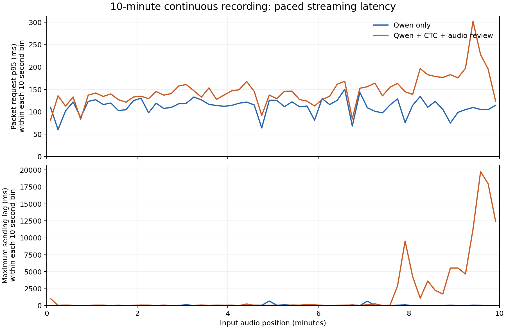

# 10 分钟多实体视频原音：流式速度与稳定性

选用星球研究所与中国水利水电科学研究院联合制作的[《为14亿人保卫江河，有多难？》](https://www.bilibili.com/video/BV1Aa4y127tu/)，本地对应原音为 `测试音频4.mp3`。测试取 01:00–11:00 的连续 600 秒，无拼接、无插入静音。包含水库、河流、引水工程、地名、研究机构和自然保护区等实体。

独立水利词库共 69 条，事先列出 38 种目标拼写，如向家坝、溪洛渡、白鹤滩、乌东德、亭子口、构皮滩、秦岭、关中平原、玛多县、澜沧江、三江源国家公园等。词库依据历史内容准备，并包含输入中没有的合理水利名称；这是已知场景诊断，不是未知领域测试或未见质量测试。没有人工逐字参考，不计算 CER、实体 precision/recall。

## 结果

相同 PCM 依次运行纯 Qwen、当前 CTC＋原音复核，各一次；每 160 毫秒提交对应新增音频，共核验 7,500 个包。首包等待音频可用后才提交。模型、词库和 CTC 会话准备在计时外；没有运行下游 Web 精修。

| 指标 | 纯 Qwen | CTC＋原音复核 |
|---|---:|---:|
| 首次非空文本响应 | 2.257 秒 | 2.225 秒 |
| 总耗时，含 600 秒播放 | 600.185 秒 | 604.978 秒 |
| 最后一包提交至最终文本 | 120 毫秒 | 437 毫秒 |
| 最大发送落后音频时钟 | 0.679 秒 | **19.753 秒** |
| 最长单包请求等待 | 0.838 秒 | **10.385 秒** |
| 复核检查数 | 0 | 12 |
| 最终保留修改 | 0 | 0 |

实体组总耗时增加 **4.793 秒**，最后一包之后的等待增加 **316 毫秒**。过程中出现明显停顿，不能只凭收尾等待判断全程流畅。

约第 7.9 分钟出现 9.62 秒的相邻包之间空档；后段 568.00–599.36 秒的 197 个包连续落后音频时钟超过 5 秒，最高达 19.75 秒。这个指标是实验发送/处理链路相对音频时钟的落后量，不是字级字幕延迟。单包请求耗时与包间空档分别保留，图中第二栏展示后者造成的落后。

## 故障与质量口径

CTC 最终报告 `errors=1`，回退状态为 `ctc_audio_rejected_or_backlogged`，已接收音频计数为 **590.08 秒**。当前代码在 CTC 异常关闭后没有保留其历史声学事件和计算耗时，最终显示的零值不能解释为没有运行 CTC，也不能用于估计计算成本。

输入已核验为有限 float32，PCM/词库 SHA256 匹配；但运行日志没有保存底层异常文本。因此，尚无法区分队列上限与 worker 失败，也未隔离线程、宿主调度、日志 I/O 等影响，不能证明停顿的具体根因。**这是一条包含运行回退的结果，不是正常 CTC 全程运行的延迟保证。**

两组首轮主转写逐字一致，实体组最终文本也与自身主转写一致。38 种预先列出的目标拼写在两组最终文本中全部出现，实体模块没有新增命中或最终误改。这只说明本例的目标词面已被原始 ASR 覆盖，不等于整段转写准确率 100%；该视频适合长时间稳定性诊断，无法证明困难实体纠错的收益。

短录音的小开销结果不能推广为当前模块在十分钟录音上的全程表现。长录音默认启用之前，需要定位停顿和回退，并在修复后使用新冻结输入重新验证。

## 文件

- `manifest.json`：视频来源、截取范围、完整词库和目标词。
- `REPORT.md` / `timing_audit.json`：逐分钟请求分布、目标拼写首次观察、配对时间差。
- `failure_audit.json`：超过 5 秒落后的区间、包间空档和错误状态。
- `run/results.jsonl` / `run/events.jsonl`：完整结果和逐包事件。
- `verification.json`：哈希、7500 包时序与服务健康核验。
- `water_60_660.wav`：可试听的连续十分钟测试输入。
